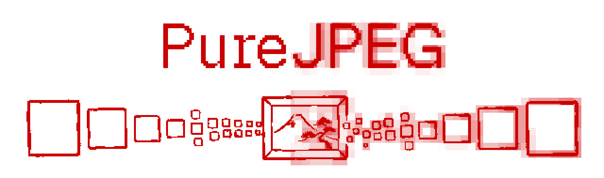
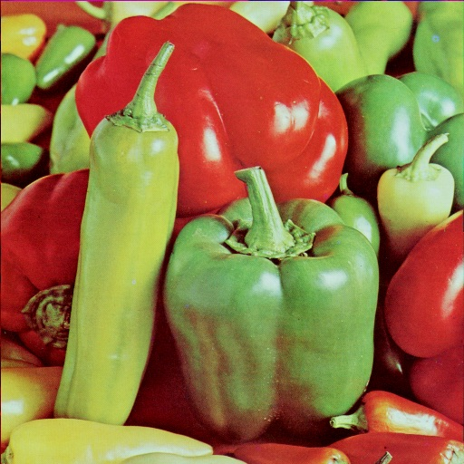
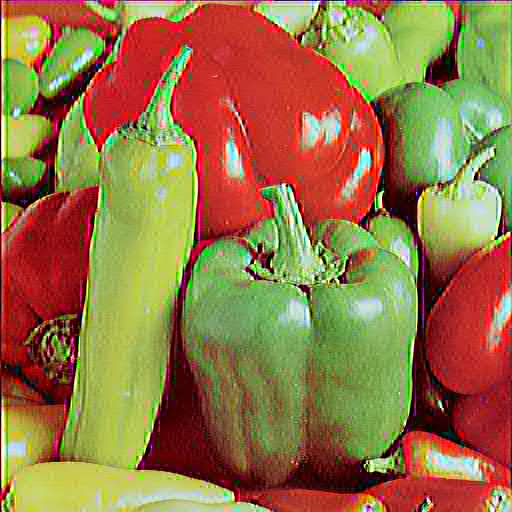
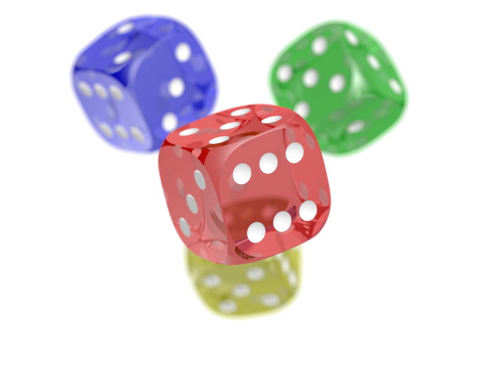
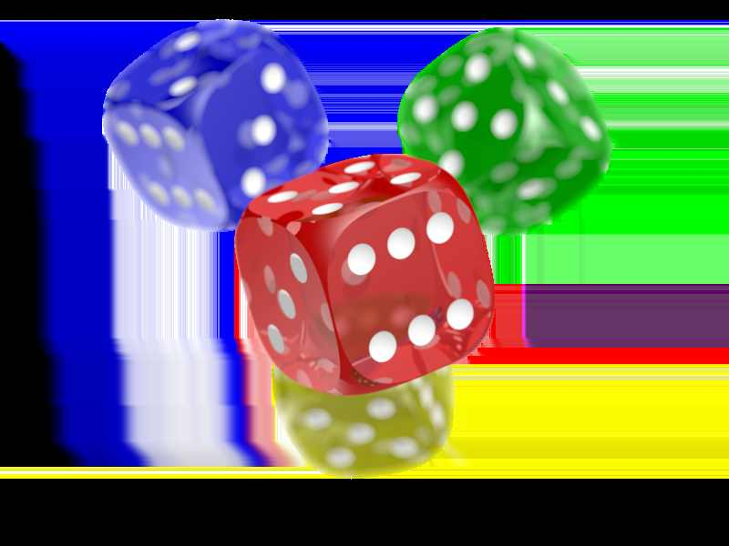

<p align="center">
  
</p>

# PureJPEG - Pure Ruby JPEG encoder and decoder library

Convert PNG or other pixel data to JPEG or the other way! Implements baseline JPEG encoding (DCT, Huffman, 4:2:0 chroma subsampling) and decodes both baseline and progressive JPEGs. Exposes a variety of encoding options to adjust parts of the JPEG pipeline not normally available (I needed this to recreate the JPEG compression styles of older digital cameras - more on this later...)

It works on CRuby 3.0+, TruffleRuby 33.0+, JRuby 9.4+, and recent versions of [Spinel](https://github.com/matz/spinel). Tests include external JPEG fixtures with pixel expectations generated by libjpeg-turbo, alongside round-trip and malformed-input checks.

> [!NOTE]
> Rubyists might find the [AI Disclosure](#ai-disclosure) section below of interest.

## Installation

You know the drill: 

```ruby
gem "pure_jpeg"
```

```
gem install pure_jpeg
```

> [!NOTE]
> Using [Spinel](https://github.com/matz/spinel)? Add PureJPEG from your Spin project directory:
>
> ```sh
> spin add pure_jpeg --git https://github.com/peterc/pure_jpeg
> ```
>
> Then use `require "pure_jpeg"` in your code as usual.

There are no runtime dependencies. [ChunkyPNG](https://github.com/wvanbergen/chunky_png) is optional (though quite useful) if you want to use `from_chunky_png`.

`examples/` contains some useful example scripts for basic JPEG to PNG and PNG to JPEG conversion if you want to do some quick tests without writing code.

## Encoding (making JPEGs!)

### From ChunkyPNG (easiest to get started)

```ruby
require "chunky_png"
require "pure_jpeg"

image = ChunkyPNG::Image.from_file("photo.png")
PureJPEG.from_chunky_png(image, quality: 80).write("photo.jpg")
```

If you want transparent pixels composited against a solid color instead of
using the PNG's hidden RGB values, pass an RGB background:

```ruby
PureJPEG.from_chunky_png(image, background: [255, 255, 255], quality: 80).write("photo.jpg")
```

### From any pixel source

PureJPEG accepts any object that responds to `width`, `height`, and `[x, y]` (returning an object with `.r`, `.g`, `.b` in 0-255):

```ruby
require "pure_jpeg"

encoder = PureJPEG.encode(source, quality: 85)
encoder.write("output.jpg")

# Or get raw bytes
jpeg_data = encoder.to_bytes
```

### From raw pixel data

```ruby
source = PureJPEG::Source::RawSource.new(width, height) do |x, y|
  [r, g, b]  # return RGB values 0-255
end

PureJPEG.encode(source).write("output.jpg")
```

### Grayscale

```ruby
PureJPEG.encode(source, grayscale: true).write("gray.jpg")
```

### Encoder options

```ruby
PureJPEG.encode(source,
  quality: 85,                    # 1-100, overall compression level
  grayscale: false,               # single-channel grayscale mode
  chroma_quality: nil,            # 1-100, independent Cb/Cr quality (defaults to quality)
  luminance_table: nil,           # custom 64-element quantization table for Y
  chrominance_table: nil,         # custom 64-element quantization table for Cb/Cr
  quantization_modifier: nil,     # proc(table, :luminance/:chrominance) -> modified table
  scramble_quantization: false,   # intentionally misordered quant tables (creative effect)
  optimize_huffman: false         # slower 2-pass encode, usually smaller files
)
```

See [CREATIVE.md](CREATIVE.md) for detailed examples of the creative encoding options.

Here's a quick example of sort of the "old digital camera" effect I was looking for though:

<table>
<tr>
<td align="center"><strong>Normal</strong></td>
<td align="center"><strong>Scrambled quantization</strong></td>
</tr>
<tr>
<td></td>
<td></td>
</tr>
</table>

And here's what happens when you convert a PNG with transparency without a `background:` — JPEG doesn't support alpha, so the hidden RGB data behind transparent pixels bleeds through:

<table>
<tr>
<td align="center"><strong>PNG with transparency</strong></td>
<td align="center"><strong>Converted to JPEG</strong></td>
</tr>
<tr>
<td></td>
<td></td>
</tr>
</table>

Pass `background: [255, 255, 255]` to composite transparent pixels over white, or any other `[r, g, b]` color you prefer.

Note that each stage of the JPEG pipeline is a separate module, so individual components (DCT, quantization, Huffman coding) can be replaced or extended independently which is kinda my plan here as I made this to play around with effects.

## Decoding (reading JPEGs!)

### From file

```ruby
image = PureJPEG.read("photo.jpg")
image.width   # => 1024
image.height  # => 768
pixel = image[100, 200]
pixel.r  # => 182
pixel.g  # => 140
pixel.b  # => 97
```

### From binary data

```ruby
image = PureJPEG.read(jpeg_bytes)
```

### Decode size limit

Starting in 0.5.0, decoding defaults to a maximum of **8,000,000 pixels** (`width * height`).
Larger images raise `PureJPEG::DecodeError` as soon as their dimensions are read,
before scan data is collected or image buffers are allocated. Set a positive
integer `max_pixels:` to lower or raise the limit for an individual decode:

```ruby
image = PureJPEG.read("photo.jpg", max_pixels: 20_000_000)
image = PureJPEG.read(jpeg_bytes, max_pixels: 1_000_000)
```

`PureJPEG::Decoder.decode` and `PureJPEG::Decoder.new` accept the same option.
The 8192-pixel limit on each axis still applies. Raising `max_pixels:` permits
higher memory use; the pixel limit is not a hard process-memory limit.
`PureJPEG.info` can inspect larger images without decoding their pixels.

### Read dimensions and metadata only

```ruby
info = PureJPEG.info("photo.jpg")
info.width           # => 1024
info.height          # => 768
info.component_count # => 3
info.progressive     # => false
info.icc_profile     # => binary profile bytes, or nil
```

Metadata queries read headers through the first scan marker, without decoding
pixels. Incomplete or inconsistent multipart ICC profiles are ignored and
reported as `nil`. ICC extraction does not perform color-profile conversion.

### Iterating pixels

```ruby
image.each_pixel do |x, y, pixel|
  puts "#{x},#{y}: rgb(#{pixel.r}, #{pixel.g}, #{pixel.b})"
end
```

### Re-encoding

A decoded `PureJPEG::Image` implements the same pixel source interface, so it can be passed directly back to the encoder:

```ruby
image = PureJPEG.read("input.jpg")
PureJPEG.encode(image, quality: 60).write("recompressed.jpg")
```

### Converting to PNG (with ChunkyPNG)

```ruby
image = PureJPEG.read("photo.jpg")

png = ChunkyPNG::Image.new(image.width, image.height)
image.each_pixel do |x, y, pixel|
  png[x, y] = ChunkyPNG::Color.rgb(pixel.r, pixel.g, pixel.b)
end
png.save("photo.png")
```

## Format support

Encoding:
- Baseline DCT (SOF0)
- 8-bit precision
- Grayscale (1 component) and YCbCr color (3 components)
- 4:2:0 chroma subsampling (color) or no subsampling (grayscale)
- Standard Huffman tables (Annex K) by default
- Optional image-specific optimized Huffman tables

Decoding:
- Baseline DCT (SOF0) and Progressive DCT (SOF2)
- 8-bit precision
- 1-component (grayscale) and 3-component (YCbCr) images
- Any chroma subsampling factor (4:4:4, 4:2:2, 4:2:0, etc.)
- Restart markers (DRI/RST)
- Separate component scans in baseline JPEGs

Encoding and decoding allow dimensions up to 8192 pixels on each axis. Decoding
also limits image area to 8,000,000 pixels by default, configurable with
`max_pixels:`. The decoder keeps the compressed scans and the final packed
RGB image in memory. It reuses one MCU row of sample and coefficient buffers
across the image, including for progressive JPEGs. `PureJPEG.info` can inspect
dimensions without allocating pixel buffers and does not apply the decode pixel limit.
Invalid or unsupported JPEG data raises `PureJPEG::DecodeError`.

Not supported: arithmetic coding, 12-bit precision, RGB/CMYK JPEG color spaces,
or EXIF/ICC profile preservation when re-encoding. Transparent PNG sources can
be composited with the explicit `background:` option above. Raise an issue if
you need one of the unsupported formats!

Possible future improvements: ICC profile rendering/conversion.

## Performance

PureJPEG 0.5.0 on an Apple M5 with 32 GiB of RAM (macOS 27.2.1). The tables use CRuby with YJIT, TruffleRuby native, JRuby with its default JIT on OpenJDK 21.0.10, and an ahead-of-time Spinel build.

### Time per image (ms)

Each cell is the median of 15 calls after 20 seconds of warmup for that operation. Inputs were already in memory and the runtimes ran sequentially. All four produced identical JPEG bytes for the encode and identical pixels for each decode.

| Bundled 1024×1024 image | CRuby 4.0.10 | TruffleRuby 40.0.0 | JRuby 10.1.3.0 | Spinel `4a7a5c8a9` |
|---|---:|---:|---:|---:|
| Encode color, quality 85 | 133 | 49 | 976 | 114 |
| Decode baseline | 117 | 26 | 635 | 39 |
| Decode progressive | 140 | 25 | 1956 | 55 |

> [!NOTE]
> I am looking into the JRuby numbers above as they are a huge regression on JRuby 9 and do not seem realistic to me.

### Peak process memory (MB)

Each cell is the median peak RSS from three fresh processes, each doing the operation once. This includes runtime startup, input loading, the codec's working memory and its output. Heap sizing and JIT activity can move these numbers around. For example, TruffleRuby's three encode runs ranged from 540 to 749 MB.

| Operation | CRuby 4.0.10 | TruffleRuby 40.0.0 | JRuby 10.1.3.0 | Spinel `4a7a5c8a9` |
|---|---:|---:|---:|---:|
| Encode color, quality 85, 1024×1024 | 46 | 584 | 1108 | 44 |
| Decode baseline, 1024×1024 | 29 | 373 | 717 | 12 |
| Decode progressive, 1024×1024 | 30 | 410 | 754 | 12 |
| Decode progressive 4:4:4, 3264×2448 | 84 | 731 | 1809 | 67 |

The last row uses a flat-color JPEG just under the default 8-million-pixel limit. The benchmark harness includes commands for reproducing the measurements on your machine. [Benchmark harness](benchmark/runtime_comparison.rb)

The encoder and decoder use the IJG accurate integer DCT and fixed-point color conversion. Decoded pixels are stored as packed RGB integers.

## Example scripts

The `examples/` directory contains ready-to-run scripts. All accept JPEG or PNG input (PNG requires the `chunky_png` gem).

**`png_to_jpeg.rb`** -- Convert a PNG to JPEG.

```
ruby examples/png_to_jpeg.rb [--grayscale] INPUT.png OUTPUT.jpg [quality]
```

**`jpeg_to_png.rb`** -- Convert a JPEG to PNG.

```
ruby examples/jpeg_to_png.rb INPUT.jpg OUTPUT.png
```

**`kodak.rb`** -- Apply the "scrambled quantization" effect that recreates the gritty look of early digicams like the Casio QV-10. See `CREATIVE.md` for more on this.

```
ruby examples/kodak.rb INPUT.(jpg|png) [OUTPUT.jpg] [quality]
```

**`lumacrush.rb`** -- Crush luminance while preserving chrominance. Produces a soft, oil-painting quality where detail is blocky but colors remain accurate.

```
ruby examples/lumacrush.rb INPUT.(jpg|png) [OUTPUT.jpg] [luma_quality] [chroma_quality]
```

**`chromacrush.rb`** -- The opposite: sharp detail with collapsed, blocky color patches.

```
ruby examples/chromacrush.rb INPUT.(jpg|png) [OUTPUT.jpg] [luma_quality] [chroma_quality]
```

**`loopy.rb`** -- Re-encode a JPEG through multiple passes to see how artifacts accumulate.

```
ruby examples/loopy.rb INPUT.jpg [quality] [iterations]
```

## Some useful `rake` tasks

```
bundle install
rake test        # run the test suite
rake benchmark   # basic benchmark of encoding and decoding (5 runs after warmup)
rake profile     # CPU profile with StackProf (requires the stackprof gem)
```

The Minitest suite lives in `test/minitest/`; `rake` and `rake test` run it
with SimpleCov as before. To run one file:

```sh
bundle exec rake test TEST=test/minitest/test_raw_source.rb
```

With Spinel and Spin installed, `spin test` runs the standalone package checks
in `test/*.rb`, comparing their output with CRuby. These cover color/grayscale
round trips, metadata, and invalid input; they supplement the full Minitest
suite. See [test/SPINEL.md](test/SPINEL.md) for details and the existing
`rake test:spinel` runner.

## Full benchmark script

`benchmark/run.rb` is a more thorough benchmark that exercises the encode and decode paths in several ways. It auto-enables YJIT, warms up before measuring, and reports object allocations, throughput (iterations/second via `benchmark-ips`), best-of-N wall-clock times, and a sustained mixed workload across encode (q85, q95 optimized, grayscale) and decode (baseline and progressive).

```
ruby benchmark/run.rb                  # standard run
ruby benchmark/run.rb --quick          # single-shot wall-clock + allocations
ruby benchmark/run.rb --full           # longer run, includes YJIT runtime stats
ruby benchmark/run.rb --profile        # CPU profile with Vernier (writes JSON to /tmp)
ruby benchmark/run.rb --profile-alloc  # retained-object profile with Vernier
```

To measure decoder peak resident memory on macOS or Linux with GNU time,
run the following command. Each JPEG gets a fresh Ruby process. Omit the
paths to measure the bundled baseline and progressive images.

```sh
ruby benchmark/decode_memory.rb photo.jpg progressive.jpg
```

## AI Disclosure

**Claude Code did the majority of the work.** The math of JPEG encoding/decoding is beyond me, except 'getting it' at a high level. I understand it like I understand the engine in my car :-) *Later update: OpenAI Codex is also reviewing and adding features now. It feels stronger in many areas.*

**I have read all of the code produced up to v0.2.0.** The algorithms are above my paygrade, but I'm OK with what has been produced, and I manually fixed a variety of stylistic things along the way. For example, CC seems to like wrapping entire functions in `if` statements rather than bailing on the opposite condition. *Later update: I have not read the ICC and optimized Huffman code yet, but it is heavily tested.*

**CC needed a lot of guidance.** Its initial JPEG algorithm was somewhat naive and output odd looking JPEGs akin to those of my [Casio QV-10 digital camera](https://medium.com/people-gadgets/the-gadget-we-miss-the-casio-qv-10-digital-camera-c25ab786ce49) from the late 1990s. After some back and forth and image comparisons, we figured out it was doing the quantization entirely wrong (specifically not using the zigzag approach during quanitization but just going in raster order). I *like* this aesthetic, but fixed it up so that it works as a generally usable JPEG library, while adding ways to customize things so you can recreate the effect, if preferred (see `CREATIVE.md` for more on that).

**CC is lazy.** The initial implementation was VERY SLOW. It took 15 seconds to turn a 1024x1024 PNG into a JPEG, so we went down the profiling rabbit hole and found many optimizations to make it ~6x faster. CC is poor at considering the role of Ruby's GC when implementing low level algorithms and needs some prodding to make the correct optimizations. CC is also lazy to the point of recommending that you just use another language (e.g. Go or Rust) rather than do a pure Ruby version of something - despite it being possible with some extra work.

**CC's testing and cleanliness leaves a bit to be desired.** The CC-created tests were superficial, so I worked on getting them beefed up to tackle a variety of edge cases. They could still get better. It also didn't do RDoc comments, use Minitest, and a variety of other things I coerced it into working on. A good `CLAUDE.md` file could probably avoid many of these problems. I worked without one.

**The overall experience was good.** I enjoyed this project, but CC clearly requires an experienced developer to keep it on the rails and to not end up with a bunch of buggy half-working crap. Getting to the basic 'turn a PNG into a JPEG' took only twenty minutes, but the rest of making it actually widely useful took several hours more.

**The final 10% still takes 90% of the time.** As mentioned above, the first run was quick, but getting things right has taken much longer. v0.1->0.2 has taken longer than 0.1 did! But we now have progressive JPEG support, even more optimizations, better tests, etc. etc.

## Credits

- [Ufuk Kayserilioglu](https://github.com/paracycle) - Major performance optimizations including integer-scaled AAN DCT, fixed-point color space conversion, and YJIT-targeted improvements.
- [Keith R. Bennett](https://github.com/keithrbennett) - Coverage testing and adding SimpleCov to the project.

## License

MIT, with IJG terms for the adapted integer DCT implementation. This software
is based in part on the work of the Independent JPEG Group. See [LICENSE](LICENSE)
and [LICENSE-IJG](LICENSE-IJG) for the notices and adaptation details.
